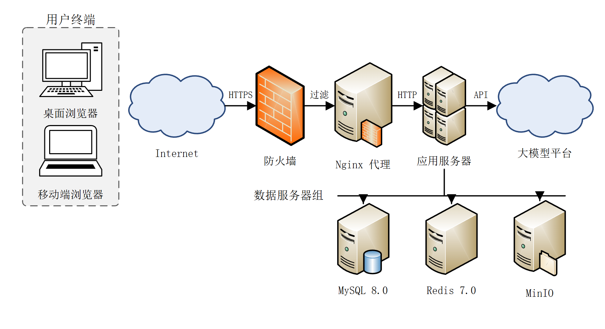
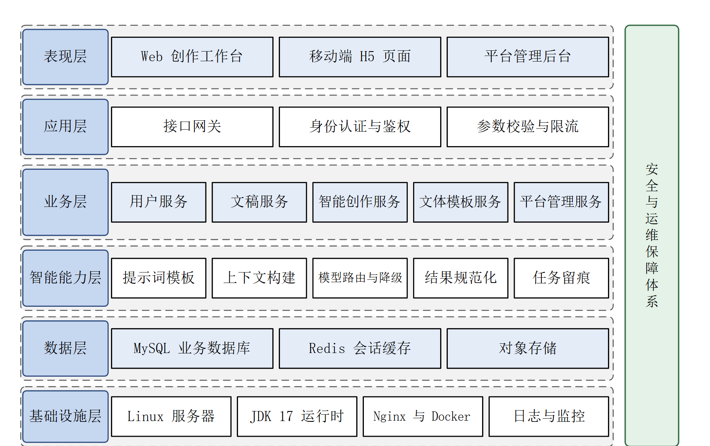

# Visio-painting

用代码画 Visio 工程图：厘米坐标精确摆放，**一张图同时得到可视图（png / svg / emf）与可编辑的 `.vsdx` 源文件**。

    

给毕业设计、课程设计、需求规格说明书 / 设计文档画成体系的工程插图：UML 用例图 / 活动图 / 时序图、陈氏 E-R 图、分层架构图、模块结构图、网络拓扑图。

## 真实产物

下面两张图是 `scripts/recipes/network.py`、`scripts/recipes/architecture.py` **直接跑出来的结果**，未手工修图：





每张图还会同时写出一份同名 `.vsdx`：打开就是这一张图，改完不影响其他图。

## 一图一档

```
<当前项目>/
└── 图片输出/
    ├── fig3-1_系统用例图.png      ← 可视图：看、插 PPT / Markdown
    ├── fig3-1_系统用例图.vsdx     ← 源文件：单页、可单独改
    ├── fig4-1_逻辑架构图.png
    └── fig4-1_逻辑架构图.vsdx
```

- **页面尺寸 = 插入尺寸**：`S.draw(15.4, 9.7, ...)` 意味着这张图在 Word 里就占 15.4×9.7 cm，图内 9pt 的字就是 9pt。
- 每个 `.vsdx` 只含一页，页名 = 图名。
- 需要插 Word 的矢量时用 `Session(fmts=("png", "emf"))`，`word_emf.py` 会裁掉 EMF 那圈浅灰发丝边框并等比补回。

## 它替你处理了什么

| 你只写 | 它处理 |
|---|---|
| 厘米坐标、图形中心 | 换算成 Visio 的英寸 / 左下原点，页面尺寸同步设好 |
| 两个图形之间连一条线 | 按矩形 / 椭圆 / 菱形求边界交点，线不穿字 |
| 框里写中文 | 中文逐字断行，`fit_size()` 反算字号防折行 |
| `fmts=("png", "emf")` | 导出对应格式（EMF 额外做裁边补偿） |
| `S.save(d, "fig4-1_逻辑架构图")` | 位图 + 同名单页 vsdx 一起落盘 |

## 快速开始

环境：Windows + Visio 2016/2019/2021/365 + Python 3.9+ + `pip install pywin32`。

```bash
python -c "import win32com.client as w; print(w.Dispatch('Visio.Application').Version)"   # 打印 16.0 即可用
```

跑一个现成骨架（产物落在当前目录的 `图片输出/`）：

```bash
cd <你的项目目录>
python <path>/Visio-painting/scripts/recipes/usecase.py       # 用例图
python <path>/Visio-painting/scripts/recipes/activity.py      # 活动图
python <path>/Visio-painting/scripts/recipes/sequence.py      # 时序图
python <path>/Visio-painting/scripts/recipes/er.py            # E-R 图
python <path>/Visio-painting/scripts/recipes/architecture.py  # 分层架构 + 模块结构
python <path>/Visio-painting/scripts/recipes/network.py       # 网络拓扑
```

自己写（完整验证流程见 [`examples/paper_figure_set.py`](examples/paper_figure_set.py)）：

```python
import sys; sys.path.insert(0, r"<path>/Visio-painting/scripts")
from visio_engine import *

with Session() as S:                          # 默认一图一档
    d = S.draw(15.4, 9.7, "图4-1 逻辑架构图")   # 页面尺寸（cm）
    d.rrect(7.7, 1.2, 14.8, 1.3, "表现层", fill=C_BLUE_L, line_color=C_BLUE_D)
    d.rect(4.0, 3.0, 3.2, 0.9, "Web 创作工作台", size=9)
    d.line(6.0, 1.9, 6.0, 2.5, arrow_end=ARROW_FILL)
    print(S.save(d, "fig4-1_逻辑架构图"))
```

## 六类图，各自最容易翻车的点

| 图型 | 必守规则 |
|---|---|
| **用例图** | 用例列中心 = 系统边界中心；**一律单列**（双列会漏连）；关联线从参与者**躯干中线**引出；同侧两个角色纵向间距 ≥3.9cm |
| **活动图** | 菱形取 4.4×2.0cm（每行 4 汉字）；菱形与相邻活动留 ≥0.45cm 放「是/否」；异常分支右列且距主列 5cm 以上 |
| **时序图** | 首条消息距对象头 ≥0.55cm；生命线间距 ≥2.6cm；同步=实线实心箭头，返回=虚线开口箭头 |
| **E-R 图** | 连线画到**图形边界**（不能连中心，否则线穿字）；属性单行等宽排开；主键名下加下划线 |
| **分层架构** | 层名带 ≥1.85cm（否则「基础设施层」折行）；组件宽度按可用宽度均分 + `fit_size` 定字号；层间不画箭头 |
| **网络拓扑** | 一律用 Visio 内置模具；图元自带文字关掉，标签另画在图元下方 0.42cm；云形用 `Stencils.cloud()` |

完整符号规范与间距经验值：[`reference/notation.md`](reference/notation.md)；可用的模具图元名：[`reference/stencils.md`](reference/stencils.md)。

## 常用 API

| 需求 | 调用 |
|---|---|
| 矩形 / 圆角矩形 / 椭圆 / 菱形 | `d.rect` / `d.rrect` / `d.oval` / `d.diamond` |
| 直线 / 正交折线 | `d.line(..., arrow_end=ARROW_FILL)` / `d.poly([(x,y), ...])` |
| 纯文字（无框） | `d.text(cx, cy, "文字", w=6, h=0.5, size=9)` |
| 火柴人参与者 | `d.actor(cx, cy, "普通用户")` |
| 起止结点 | `d.start_node` / `d.end_node` |
| `«include»` / `«extend»` | `d.include(a, b, label="«extend»")` |
| 字号自适应 | `size=fit_size(文字, 框宽cm, 9)` |
| Visio 内置图元 | `Stencils(app).drop(d, "srv", "应用程序服务器", cx, cy, "应用服务")` |
| 云形 | `Stencils(app).cloud(d, cx, cy, 2.45, 1.6, "Internet")` |

## 装到你的 Agent

把整个 `Visio-painting/` 目录放进该 harness 读取 skill 的位置即可（Claude Code / Cursor / 通用 Agent 三种装法与 30 秒自检）：见 [`PORTABLE.md`](PORTABLE.md)。

## 限制

- **必须 Windows 且安装 Visio**；macOS / Linux 请改用 Graphviz、draw.io CLI 或 mermaid。
- 图内四周留白需 ≥ 0.35cm：EMF 导出会裁掉四周 1.4%，贴边元素会被切。
- 中文在 Visio 里逐字断行，框窄时需用 `fit_size()` 反算字号或加宽。

## 文档

- [`SKILL.md`](SKILL.md) — 适用场景判定、产物规范、用法、六类图规范、踩坑记录
- [`reference/notation.md`](reference/notation.md) — 符号与间距硬指标
- [`reference/stencils.md`](reference/stencils.md) — `Stencils.drop()` 可用的中文图元名
- [`PORTABLE.md`](PORTABLE.md) — 安装到其他 harness

## 许可

[MIT](LICENSE) © 2026 getfunWindz
